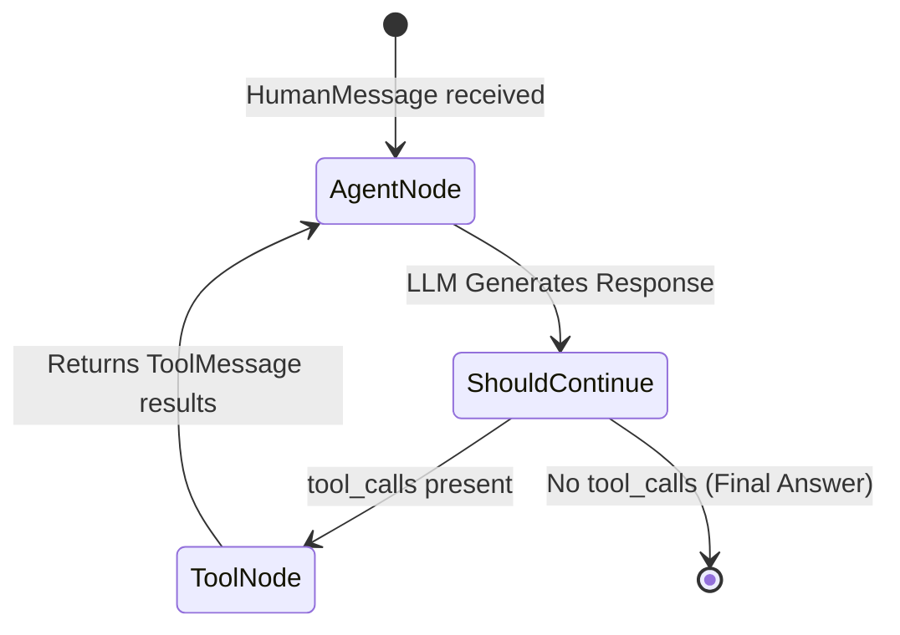

# 🐋 ORCA: Stateful Agentic RAG & Multi-Modal Conversational Platform

[](https://www.python.org/)
[](https://fastapi.tiangolo.com/)
[](https://langchain-ai.github.io/langgraph/)
[](https://astra.datastax.com/)
[](https://groq.com/)
[](https://langfuse.com/)
[](https://www.docker.com/)

---

## 📑 Table of Contents

- [Executive Overview](#-executive-overview)
- [System Architecture](#-system-architecture)
- [Key Features & Innovations](#-key-features--innovations)
- [Repository Structure](#-repository-structure)
- [Multi-Modal Ingestion Pipeline](#-multi-modal-ingestion-pipeline)
- [Stateful Agentic Engine (LangGraph)](#-stateful-agentic-engine-langgraph)
- [OWST: On-Demand Web Sandboxing & Routing](#-owst-on-demand-web-sandboxing--routing)
- [Observability, Tracing & Prompt Registry](#-observability-tracing--prompt-registry)
- [API Reference](#-api-reference)
- [Environment Variables & Configuration](#-environment-variables--configuration)
- [Getting Started & Local Development](#-getting-started--local-development)
- [Docker & Containerized Deployment](#-docker--containerized-deployment)
- [Database Schema & Data Model](#-database-schema--data-model)
- [Error Handling & Fault Tolerance](#-error-handling--fault-tolerance)
- [Core Contributors](#-core-contributors)

---

## 🔭 Executive Overview

**ORCA** is an enterprise-grade, stateful agentic Retrieval-Augmented Generation (RAG) backend. It combines high-throughput Large Language Model inference via **Groq**, serverless vectorization and storage via **DataStax Astra DB (NVIDIA NV-EmbedQA-E5-V5)**, cyclic state-machine agent execution via **LangGraph**, and end-to-end telemetry and prompt orchestration via **Langfuse**.

Unlike conventional stateless RAG wrappers, ORCA is architected around:
1. **Per-User Vector Collection Partitioning (`user_{user_id}`)**: Isolated multi-tenant storage that prevents data leakage while streamlining ingestion, scoped filtering, and deletion lifecycle management.
2. **Server-Side Vectorization**: Eliminates local embedding latency and client memory pressure by leveraging Astra DB's native NVIDIA vector service.
3. **OWST (On-Demand Web Scraping & Sandboxing / Targeted Navigation)**: An autonomous web routing engine that discovers live deep-links, strips invasive DOM elements (ads, navbars, modals), and streams clean HTML sandboxes directly to client iframes.
4. **Multi-Modal Data Grounding**: Ingests PDFs (both chunked and regular-expression extracted), CSVs, JSON datasets, live web pages, and raw images via OCR.

---

## 🏛 System Architecture

The following diagram illustrates the lifecycle of incoming requests, agent cycles, ingestion pipelines, and third-party services:

```mermaid
flowchart TB
    subgraph Clients["Frontend & Client Interfaces"]
        UI["Web / Mobile UI (React Native / Next.js)"]
        Iframe["Sandbox Iframe (Clean HTML Preview)"]
    end

    subgraph API["FastAPI Gateway (app/main.py)"]
        Cors["CORS Middleware"]
        Lifespan["App Lifespan (DB Client + Langfuse Flush)"]
        R_Chat["Chat Router (/v2/chat/stream)"]
        R_Ingest["Ingestion Router (/upload, /webupload)"]
        R_OWST["OWST Router (/owst)"]
        R_Mgmt["Management Router (/delete-*)"]
    end

    subgraph Ingestion["Multi-Modal Ingestion Engine (app/ingestion)"]
        PDF_Std["Standard PDF (PyPDFLoader + RecursiveSplitter)"]
        PDF_Adv["Advanced PDF (Regex Extractor)"]
        Data_Proc["JSON & CSV Structured Processors"]
        Web_Proc["Web Scraper (BS4 + CSS Decomposer)"]
        OCR_Svc["OCR Microservice Client (Render Session + Backoff)"]
    end

    subgraph AgenticEngine["LangGraph State Machine (app/agent)"]
        AgentNode["Agent Node (ChatGroq + Prompt Injector)"]
        Checkpointer["MemorySaver Checkpoint Engine"]
        ToolNode["ToolNode Executor"]
        
        subgraph Tools["Agent Tools (app/agent/tools.py)"]
            T_Uni["universal_knowledge_search"]
            T_Filt["filtered_knowledge_search"]
            T_OWST["owst_live_search"]
        end
    end

    subgraph External["External Cloud & Storage Services"]
        AstraDB[("DataStax Astra DB\n(nvidia/nv-embedqa-e5-v5 / 1024-d)")]
        GroqCloud["Groq Cloud LLMs\n(gpt-oss-120b, llama-3.3-70b, llama-3.1-8b)"]
        LangfuseSvc["Langfuse Cloud\n(Prompt Registry, Trace Spans & OTel)"]
        OCR_Cloud["External OCR Endpoint\n(ocr-1-0-0.onrender.com)"]
    end

    UI -->|Query + Session + Scope| R_Chat
    UI -->|Upload Files / URLs| R_Ingest
    UI -->|Load Clean Sandbox View| R_OWST
    UI -->|Delete Docs / Collection| R_Mgmt

    R_Chat --> AgenticEngine
    AgentNode <-->|ReAct Loop| ToolNode
    ToolNode --> T_Uni & T_Filt & T_OWST
    T_Uni & T_Filt --> AstraDB
    T_OWST --> GroqCloud
    AgentNode --> GroqCloud
    AgentNode -.->|Fetch Prompts & Log Generations| LangfuseSvc

    R_Ingest --> Ingestion
    PDF_Std & PDF_Adv & Data_Proc & Web_Proc --> AstraDB
    OCR_Svc --> OCR_Cloud --> AstraDB

    R_OWST -->|HTML Fetch + Decompose| Iframe
```



---

## 🌟 Key Features & Innovations

### 1. Stateful Single-Collection Multi-Tenant Partitioning
Rather than instantiating individual vector collections for every document or topic, ORCA maintains a dedicated collection per user (`user_{user_id}`). Chunks retain structured metadata (`source`, `category`, `configuration`, `uploaded_at`). This enables:
- Granular file-level deletion without vector drops.
- Scoped searches targeting specific document origins or categories.
- Automatic creation and auto-wake recovery for hibernating serverless databases.

### 2. Autonomous Agentic Reasoning with LangGraph
Powered by `langgraph`, ORCA implements a resilient StateGraph:
- **State Checkpointing**: MemorySaver checkpoints preserve dialogue history bound by `session_id`.
- **Dynamic Tool Calling**: Autonomous decision-making between universal vector retrieval, scoped retrieval, and live web routing.
- **Recursion Guard**: Bounded execution limit (`recursion_limit: 50`) prevents runaway LLM loops.
- **Macro Generation**: Emits `RENDER_OWST: <url>` macros when real-time external pages are identified as ground-truth references.

### 3. Server-Side `$vectorize` via NVIDIA Embeddings
ORCA eliminates local GPU/CPU vector calculations. Collections are configured with:
- **Vector Dimension**: `1024`
- **Distance Metric**: `Cosine`
- **Provider & Model**: `nvidia/nv-embedqa-e5-v5`
Documents passed to Astra DB include a `$vectorize` payload, allowing DataStax's ingestion engine to calculate embeddings directly.

### 4. Resilient Multi-Stage Ingestion Pipeline
- **Adaptive OCR Service Client**: Handles cold-start spin-ups (up to 50s) on free-tier Render instances using exponential backoff retry strategies (10s, 20s, 40s, 80s).
- **Regex Extraction for Specialized PDFs**: Targeted extraction for invoices, tabular IDs, contractual terms, and identifiers without cluttering vector memory with boilerplate layout text.
- **CSS Pre-Filtering**: Strips unwanted navigation menus, footer scripts, and banners prior to chunking web pages.

### 5. Enterprise Observability with Langfuse
- **Dynamic Cloud Prompt Registry**: System instructions for workspaces are fetched live from Langfuse (`langfuse.get_prompt(workspace_type)`).
- **Generation & Trace Linking**: Traced calls link LLM generations directly to the active prompt version, token usage, latency metrics, and user/session tags.

---

## 📂 Repository Structure

```
ORCA/
├── app/
│   ├── __init__.py
│   ├── main.py                     # Application entry point, lifespan, CORS, and router registration
│   ├── agent/
│   │   ├── __init__.py
│   │   ├── astra_agent.py          # LangGraph state machine, GraphState definition, and execution nodes
│   │   └── tools.py                # Agent tools: universal_search, filtered_search, owst_live_search
│   ├── api/
│   │   ├── __init__.py
│   │   ├── deps.py                 # Dependency injection: DB session, hibernation wake-up & retries
│   │   └── routes/
│   │       ├── chat.py             # POST /v2/chat/stream conversational endpoint
│   │       ├── ingestion.py        # POST /upload & POST /webupload endpoints
│   │       ├── management.py       # POST /delete-collection & POST /delete-document endpoints
│   │       └── owst.py             # GET /owst web routing & clean HTML iframe endpoint
│   ├── core/
│   │   ├── __init__.py
│   │   ├── config.py               # Pydantic BaseSettings loading .env configuration
│   │   ├── langfuse_client.py      # Langfuse client singleton, prompt compilation, and fallback logic
│   │   └── utils.py                # URL sanitization, markdown link stripping, protocol validation
│   ├── ingestion/
│   │   ├── __init__.py
│   │   ├── advance_pdf_tool.py     # Regex pattern matching and extraction for PDFs
│   │   ├── image_tool.py           # HTTP client with exponential backoff for OCR microservice
│   │   ├── json_csv_tool.py        # Tabular data parsers (CSV DictReader & JSON loader)
│   │   ├── metadata_utils.py       # Standardized metadata object generator
│   │   └── pdf_web_tool.py         # PyPDFLoader + RecursiveCharacterTextSplitter & BS4 parser
│   ├── services/
│   │   ├── __init__.py
│   │   └── owst_scraper.py         # Requests + BeautifulSoup HTML scraper with tag decomposition
│   └── storage/
│       ├── __init__.py
│       └── astra_db.py             # Astra DB collection auto-provisioning & $vectorize insertion
├── .dockerignore                   # Build-context optimization exclusions
├── .gitignore                      # Git tracking ignore patterns
├── .python-version                 # Python version declaration (3.12)
├── Dockerfile                      # Multi-stage production build (Builder + Distroless-like Slim Runtime)
├── docker-compose.yaml             # Container orchestration and volume bindings
├── pyproject.toml                  # Project metadata and top-level dependencies
├── requirements.txt                # Pinned production dependencies
└── README.md                       # Comprehensive technical documentation
```

---

## 🔄 Multi-Modal Ingestion Pipeline

ORCA standardizes every ingested document into the following Astra DB JSON document format before vectorization:

```json
{
  "data": "Raw text chunk content",
  "$vectorize": "Raw text chunk content",
  "metadata": {
    "source": "contract_2026.pdf",
    "category": "pdf_standard",
    "configuration": {
      "chunk_size": 1000,
      "chunk_overlap": 150
    },
    "uploaded_at": "2026-10-11T05:15:30.123456+00:00"
  }
}
```

### Supported Media Types & Parsing Behaviors

| Category | Input Types | Pipeline Handler | Processing Characteristics |
| :--- | :--- | :--- | :--- |
| **`pdfs` (Standard)** | `application/pdf` | `process_pdf` | Employs `PyPDFLoader` + `RecursiveCharacterTextSplitter`. Explicit `del loader` and `gc.collect()` to guarantee zero memory leaks in containerized environments. |
| **`pdfs` (Advanced)** | `application/pdf` | `process_pdf_regex` | Loops through `PdfReader.pages`, evaluates user-supplied regex patterns (`re.findall`), and vectorizes each distinct match. |
| **`csvs`** | `text/csv` | `process_csv` | Parses records via `csv.DictReader`, converting each record row into structured string representations. |
| **`jsons`** | `application/json` | `process_json` | Accepts JSON lists or isolated dict objects, vectorizing individual items while preserving payload integrity. |
| **`images`** | `jpeg`, `png`, `webp` | `process_image` | Dispatches binary streams to the OCR microservice with resilient HTTP connection pooling (5 retries, 10s backoff factor). |
| **`web_page`** | HTTP/HTTPS URL | `process_web` | Fetches HTML using `requests`, decomposes intrusive CSS classes (e.g. `navbar`, `ad-banner`), strips text, and chunks recursively. |

---

## 🧠 Stateful Agentic Engine (LangGraph)

The agent workflow is encapsulated inside `AstraAgent` (`app/agent/astra_agent.py`):



### 1. State Definition (`GraphState`)
```python
class GraphState(TypedDict):
    messages: Annotated[list, add_messages]
    user_id: str
    workspace_type: str
    scope_filters: Optional[List[str]]
    owst_context: Optional[List[dict]]
```

### 2. Available Agent Tools (`app/agent/tools.py`)

1. **`universal_knowledge_search(query: str)`**:
   Executes a vector search over the user's Astra DB collection without restrictions:
   ```python
   user_collection.find(sort={"$vectorize": query}, limit=5, projection={"data": True, "metadata": True})
   ```
2. **`filtered_knowledge_search(query: str, sources: List[str], categories: List[str])`**:
   Scopes vector searches to specific files or categories via Astra DB `$in` operators:
   ```python
   filter_dict = {
       "metadata.source": {"$in": sources},
       "metadata.category": {"$in": categories}
   }
   ```
3. **`owst_live_search(query: str, base_domain: Optional[str])`**:
   Resolves specific URLs for live information. Evaluates against a two-tier LLM cascade (`llama-3.3-70b-versatile` falling back to `llama-3.1-8b-instant`) with JSON sanitization and regular expression URL extractors.

### 3. Citations & Macro Emission
- When `owst_live_search` successfully determines a web URL, the router attaches a macro flag: `RENDER_OWST: <url>`.
- Client interfaces inspect `macro` to automatically render the page in an embedded sandbox iframe.
- Sources referenced in answers are extracted via regex `[cite: <source_name>]` or fallback to tool invocation metadata.

---

## 🌐 OWST: On-Demand Web Sandboxing & Routing

OWST (**On-Demand Web Scraping & Sandboxing / Targeted Navigation**) allows ORCA to bridge internal vector data with live, unindexed web pages without compromising UI readability.

### Operational Sequence:
1. **Target Identification**: A query directed to `/owst` triggers the `owst_router` prompt registered in Langfuse.
2. **LLM Routing**: The router executes against `groq/compound` or `groq/compound-mini` at `temperature: 0.0`.
3. **DOM Cleaning (`app/services/owst_scraper.py`)**:
   - Performs an HTTP request with modern desktop browser headers.
   - Parses the DOM tree with BeautifulSoup.
   - Decomposes every element identified in `classes_to_remove` (e.g., `header`, `cookie-banner`, `footer`, `nav-drawer`).
4. **HTML Rendering**: Returns the cleaned HTML directly with `HTMLResponse(status_code=200)` for iframe consumption.

---

## 📊 Observability, Tracing & Prompt Registry

ORCA implements **Langfuse v3/v4** standards for observability:

### Prompt Registry Integration
System prompts are not hardcoded. The application retrieves version-controlled prompt templates from the Langfuse prompt registry:
```python
prompt_obj = langfuse.get_prompt(workspace_type)
compiled = prompt_obj.compile(scope_filters=scope_filters, attached_domain=attached_domain)
```
If Langfuse is temporarily unreachable, ORCA falls back to:
`"You are ORCA, an advanced virtual assistant. Use your tools to find accurate information."`

### OpenTelemetry Generation Tracing
When an LLM call executes, `langfuse.update_current_generation` binds:
- The compiled prompt object.
- The model identifier.
- Token counts (`prompt_tokens`, `completion_tokens`, `total_tokens`).
- Execution duration and metadata.

### Trace Flushes & Lifespan Hooks
To prevent lost traces in serverless or container restarts:
- `ChatResponse` triggers `langfuse_client.flush()` in a `finally` block.
- FastAPI's lifespan shutdown handler forces a complete buffer drain before server shutdown.

---

## 🔌 API Reference

### 1. Health Check
```http
GET /
```
**Response (200 OK):**
```json
{
  "status": "ORCA Agentic Services are running successfully!"
}
```

---

### 2. Conversational Agent Stream
```http
POST /v2/chat/stream
Content-Type: application/json
```
**Request Body:**
```json
{
  "session_id": "session_98234",
  "user_id": "usr_alpha_44",
  "model": "openai/gpt-oss-120b",
  "query": "What are our Q3 financial results according to the uploaded summary?",
  "workspace_type": "finance_analyst",
  "scope_filters": ["q3_report.pdf"],
  "owst_context": [
    {
      "source_id": "src_fin_web",
      "base_url": "https://ir.company.com",
      "classes_to_remove": ["site-nav", "ad-unit"]
    }
  ]
}
```

**Response Body (200 OK):**
```json
{
  "response": "According to the Q3 financial summary [cite: q3_report.pdf], revenue increased by 14% year-over-year.",
  "sources": ["q3_report.pdf"],
  "macro": null
}
```

---

### 3. Multi-Modal File Ingestion
```http
POST /upload
Content-Type: multipart/form-data
```
**Form Parameters:**
| Parameter | Type | Required | Description |
| :--- | :--- | :--- | :--- |
| `user_id` | `string` | **Yes** | Unique identifier for user collection partition |
| `file` | `UploadFile` | **Yes** | Binary payload (PDF, CSV, JSON, JPEG, PNG, WebP) |
| `pdfoption` | `string` | No | `"adv"` for regex mode, omit or `"std"` for chunking |
| `regex` | `string` | No | Regular expression pattern (required if `pdfoption="adv"`) |
| `range_val` | `integer`| No | Chunk size for standard PDF processing (e.g., `1000`) |
| `overlap` | `integer`| No | Chunk overlap for standard PDF processing (e.g., `150`) |

**cURL Example:**
```bash
curl -X POST "http://localhost:8000/upload" \
  -F "user_id=usr_alpha_44" \
  -F "file=@./annual_report.pdf" \
  -F "range_val=1000" \
  -F "overlap=150"
```

**Response (200 OK):**
```json
{
  "response": "Successfully inserted 28 items into 'user_usr_alpha_44'."
}
```

---

### 4. Web Page Ingestion
```http
POST /webupload
Content-Type: application/x-www-form-urlencoded
```
**Parameters:**
- `user_id`: `"usr_alpha_44"`
- `link`: `"https://docs.datastax.com/en/astra-db-serverless"`
- `range_val`: `1000`
- `overlap`: `150`

**Response (200 OK):**
```json
{
  "response": "Successfully inserted 14 items into 'user_usr_alpha_44'."
}
```

---

### 5. OWST Clean Sandbox Fetch
```http
GET /owst?link=https://example.com&query=documentation&classes_to_remove=navbar,footer,sidebar
```
**Response (200 OK):**
Returns `text/html` containing the target document with all matching CSS elements excised.

---

### 6. Document & Collection Management

#### Delete Specific Document Chunks
```http
POST /delete-document
Content-Type: application/json
```
```json
{
  "user_id": "usr_alpha_44",
  "source_filename": "annual_report.pdf"
}
```
**Response (200 OK):**
```json
{
  "response": "Deleted 28 chunks for source 'annual_report.pdf'."
}
```

#### Wipe Entire User Collection
```http
POST /delete-collection
Content-Type: application/json
```
```json
{
  "user_id": "usr_alpha_44"
}
```
**Response (200 OK):**
```json
{
  "response": "Collection 'user_usr_alpha_44' deleted successfully."
}
```

---

## ⚙️ Environment Variables & Configuration

Configuration is managed via Pydantic `BaseSettings` (`app/core/config.py`), reading from `.env`:

| Key | Type | Default | Description |
| :--- | :--- | :--- | :--- |
| `ASTRA_DB_APPLICATION_TOKEN` | `string` | *Required* | DataStax Astra DB Application Token (`AstraCS:...`) |
| `ASTRA_DB_API_ENDPOINT` | `string` | *Required* | Database API Endpoint (`https://<id>-<region>.apps.astra.datastax.com`) |
| `GROQ_API_KEY` | `string` | *Required* | API Key for Groq Cloud inference (`gsk_...`) |
| `LANGFUSE_PUBLIC_KEY` | `string` | *Required* | Langfuse project public API key (`pk-lf-...`) |
| `LANGFUSE_SECRET_KEY` | `string` | *Required* | Langfuse project secret API key (`sk-lf-...`) |
| `LANGFUSE_HOST` | `string` | `https://cloud.langfuse.com` | Base URL for the Langfuse cloud or self-hosted instance |
| `GOOGLE_SEARCH_KEY` | `string` | *Required* | Google Custom Search JSON API Key |
| `GOOGLE_SEARCH_CX` | `string` | *Required* | Google Programmable Search Engine CX ID |
| `GOOGLE_SEARCH_URL` | `string` | `https://www.googleapis.com/customsearch/v1` | Google Custom Search API base endpoint |

---

## 🚀 Getting Started & Local Development

### Prerequisites
- **Python 3.12+**
- **Astra DB Account**: A serverless vector database enabled with the NVIDIA vectorize integration.
- **Groq API Key**: With model access to `gpt-oss-120b`, `llama-3.3-70b-versatile`, etc.
- **Langfuse Account**: For prompt tracking and OTel observability.

### 1. Clone & Set Up Virtual Environment

```bash
# Clone the repository
git clone https://github.com/GauravPatil1444/ORCA.git
cd ORCA

# Create and activate Python 3.12 virtual environment
python -m venv .venv

# On Linux/macOS:
source .venv/bin/activate
# On Windows PowerShell:
.venv\Scripts\Activate.ps1
```

### 2. Install Dependencies

Using `pip`:
```bash
pip install -r requirements.txt
```

Or using `uv` (recommended for ultra-fast dependency resolution):
```bash
uv pip install -r requirements.txt
```

### 3. Configure Environment

Create a `.env` file in the project root:
```env
ASTRA_DB_APPLICATION_TOKEN=AstraCS:your_token_here
ASTRA_DB_API_ENDPOINT=https://your-database-id-region.apps.astra.datastax.com
GROQ_API_KEY=gsk_your_groq_key_here
LANGFUSE_PUBLIC_KEY=pk-lf-your_public_key
LANGFUSE_SECRET_KEY=sk-lf-your_secret_key
LANGFUSE_HOST=https://cloud.langfuse.com
GOOGLE_SEARCH_KEY=your_google_search_api_key
GOOGLE_SEARCH_CX=your_custom_search_engine_cx
```

### 4. Run the Development Server

```bash
uvicorn app.main:app --host 0.0.0.0 --port 8000 --reload
```

The interactive OpenAPI / Swagger documentation will be available at:
👉 **`http://localhost:8000/docs`**

---

## 🐳 Docker & Containerized Deployment

ORCA utilizes a hardened **two-stage build Dockerfile** to deliver a minimal, secure production image:
- **Builder Stage**: Compiles C-extensions (`lxml`, `uvloop`, headers) into an isolated virtual environment (`/opt/venv`).
- **Runtime Stage**: Copies *only* the compiled virtual environment into `python:3.12-slim`, discarding compilers (`gcc`, `build-essential`), stripping over 200MB of build tools.
- **Security**: Creates an unprivileged system user (`appuser`), drops root permissions, and enforces non-root execution.
- **Healthcheck**: Uses Python standard library `urllib.request` to poll `http://localhost:8000/` every 30s.

### Building & Running with Docker

```bash
# Build the image
docker build -t orca-agentic-backend .

# Run the container
docker run -d \
  --name orca_agentic_api \
  -p 8000:8000 \
  --env-file .env \
  orca-agentic-backend
```

### Orchestrating with Docker Compose

A pre-configured `docker-compose.yaml` is provided:

```bash
# Start container in detached mode
docker compose up -d

# Check running status and health check
docker compose ps

# View live container logs
docker compose logs -f

# Teardown container
docker compose down
```

---

## 🗄 Database Schema & Data Model

### Collection Provisioning Strategy
When data is first uploaded for a `user_id`, ORCA provisions an Astra DB vector collection if one does not already exist:

```python
collection_definition = (
    CollectionDefinition.builder()
    .set_vector_dimension(1024)
    .set_vector_metric(VectorMetric.COSINE)
    .set_vector_service(
        provider="nvidia",
        model_name="nvidia/nv-embedqa-e5-v5",
    )
    .build()
)
```

### Metadata Taxonomy
Every stored document chunk includes standardized metadata:
```json
{
  "source": "<Filename, URL, or Identifier>",
  "category": "<pdf_standard | pdf_regex | csv | json | image | web_page>",
  "configuration": {
    "chunk_size": 1000,
    "chunk_overlap": 150,
    "regex_expression": "..."
  },
  "uploaded_at": "<ISO-8601 UTC Timestamp>"
}
```

---

## 🛡 Fault Tolerance & Reliability Patterns

1. **Astra DB Cold-Start Auto-Wake (`app/api/deps.py`)**:
   Free and serverless Astra DB instances hibernate during periods of inactivity. ORCA wraps collection acquisition in a 3-attempt retry loop:
   ```python
   except (DataAPIHttpException, Exception) as e:
       if "503" in str(e) and attempt < max_retries - 1:
           time.sleep(5)  # Pause and wait for DB instance spin-up
           continue
   ```
2. **OCR Connection Pooling & SSLEOF Resilience (`app/ingestion/image_tool.py`)**:
   External free-tier microservices often trigger HTTP timeouts or dropped SSL connections (`SSLEOFError`). The OCR client mounts an `HTTPAdapter` configured with `Retry(total=5, backoff_factor=10, status_forcelist=[429, 500, 502, 503, 504])`.
3. **Graph Recursion Safeguards**:
   LangGraph executions are capped at 50 recursion cycles. If ambiguous user queries trigger looping behavior, the agent intercepts `GraphRecursionError` and returns a polite guidance response instead of crashing with HTTP 500.
4. **LLM Fallback Cascades**:
   - Web Routing: Tries `llama-3.3-70b-versatile`; on rate limits or errors, falls back to `llama-3.1-8b-instant`.
   - OWST Iframe Routing: Tries `groq/compound`; on overload/429 errors, falls back to `groq/compound-mini`.

